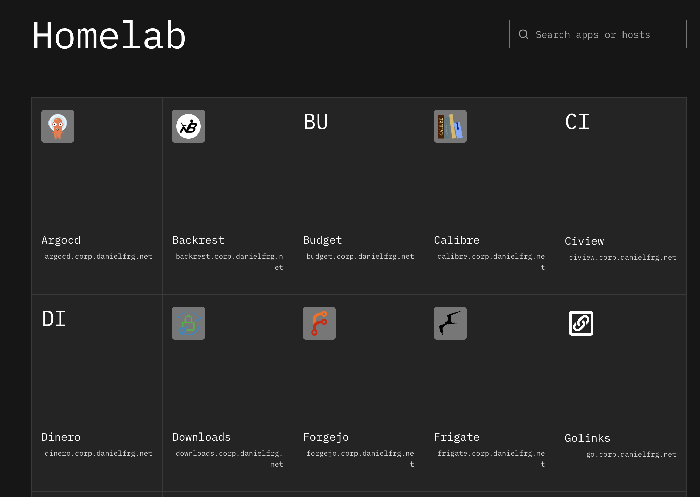

# Homelab Launcher

A read-only launchpad for finding and opening applications discovered from
Kubernetes Gateway API HTTPRoutes. Route annotations supply presentation metadata;
there is no separate app inventory.



## Installation

### Docker

For local use with a kubeconfig whose API endpoint is reachable from the container:

```zsh
docker run -d --name homelab-launcher \
  -p 127.0.0.1:8080:8080 \
  -v "${HOME}/.kube:/kube:ro" \
  -e KUBECONFIG=/kube/config \
  ghcr.io/danielfrg/homelab-launcher:latest
```

Open [http://localhost:8080](http://localhost:8080). The container runs as
UID/GID 65532; mounted credentials must be readable by that user. Kubeconfigs
that reference external certificate files need those files mounted too. Exec
credential plugins require a custom image containing the plugin.

In Kubernetes, use a dedicated ServiceAccount with a ClusterRole granting only
`list` on `httproutes` in `gateway.networking.k8s.io`, bound through a
ClusterRoleBinding. Mount its token for in-cluster discovery. The container
listens on port 8080.

### Standalone

Build from source using the [build instructions](#build), then run:

```zsh
./homelab-launcher
```

Open [http://127.0.0.1:8080](http://127.0.0.1:8080). Kubernetes access uses
the current kubeconfig context; `KUBECONFIG` can select another configuration.

## Usage

The launcher lists Gateway API v1 HTTPRoutes across namespaces. Each route
becomes one app: its first valid concrete hostname forms the HTTPS link, and
additional hostnames are searchable aliases. No domain configuration, app
inventory, or network-specific defaults are needed. Hostless routes and
wildcard hostnames are skipped because they do not identify a concrete URL.
HTTPS is the link convention; Gateway listener protocols are not inspected.

Names are derived from route names. Optional annotations customize presentation:

```yaml
metadata:
  annotations:
    homelab-launcher/name: "File Browser"
    homelab-launcher/description: "Shared files"
    homelab-launcher/group: "Tools"
    homelab-launcher/icon: "mdi-folder"
```

Set `homelab-launcher/enabled: "false"` to hide any route, including the
launcher's own route. Unannotated routes are included, with group `Apps`.
Icons use dashboard-icons names or `mdi-` names for Material Design icons.

## Configuration

| Variable | Default | Purpose |
| --- | --- | --- |
| `HOMELAB_LAUNCHER_ADDR` | `127.0.0.1:8080` | HTTP listen address |
| `HOMELAB_LAUNCHER_API_TARGET` | `http://127.0.0.1:8080` | Frontend development proxy |
| `HOMELAB_LAUNCHER_FRONTEND_PORT` | `5173` | Frontend development listen port |
| `KUBECONFIG` | Standard kubeconfig loading | Local Kubernetes credentials |

Search covers names, descriptions, groups, primary hostnames, and aliases.
Discovery caches results for 30 seconds and keeps the last successful snapshot
when a refresh fails. Retry bypasses the cache. Discovery does not check app health.
API documentation is at `/api/docs`.

Liveness is `/healthz`; readiness is `/readyz`. Both check the running HTTP
service independently of Kubernetes availability, keeping stale links usable
during cluster API outages.

## Development

Requires Go 1.25, Node 26, pnpm 10, and just.

The API needs a working Kubernetes context with permission to list HTTPRoutes.
If your credentials are outside the default kubeconfig, or another project uses
the default ports, create a root `.env` file (ignored by Git):

```dotenv
KUBECONFIG=/path/to/kubeconfig
HOMELAB_LAUNCHER_ADDR=127.0.0.1:8081
HOMELAB_LAUNCHER_API_TARGET=http://127.0.0.1:8081
HOMELAB_LAUNCHER_FRONTEND_PORT=5174
```

`just` loads this file for both commands. With these example ports, open
[http://127.0.0.1:5174](http://127.0.0.1:5174).

```zsh
just install
just api
```

In another terminal:

```zsh
just frontend
```

Open [http://127.0.0.1:5173](http://127.0.0.1:5173). Vite proxies API
requests to the Go server. Run `just check` for Go race tests, vet, frontend
tests, and Svelte/TypeScript checks.

The repositories share this structure:

```text
cmd/<app>/              Configuration and server lifecycle
internal/               Go application packages
internal/httpapi/       HTTP API and health probes
internal/web/           Embedded frontend and static serving
frontend/src/theme.css  Shared palette, typography, and font definitions
frontend/src/app.css    Application layouts and interactions
scripts/                Container smoke test
docs/screenshots/       README screenshots
```

The shared theme loads Inter and IBM Plex Mono from Google Fonts, with dark, light,
and system preferences. Dark is the default; the header theme control saves
your choice. Keep `frontend/src/theme.css` identical across these projects.
`PRODUCT.md` describes users and purpose; `DESIGN.md` records interface rules.
Local plans, agent reports, and design-tool state stay out of Git.

## Build

```zsh
just build
```

The executable embeds the built frontend and needs no Node runtime. Build and
smoke-test a local container with:

```zsh
just image-check
```

Published images support Linux AMD64 and ARM64. `latest` tracks `main`;
`sha-<commit>` tags and image digests can pin a deployment.
